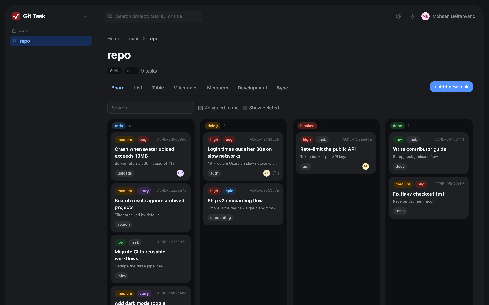
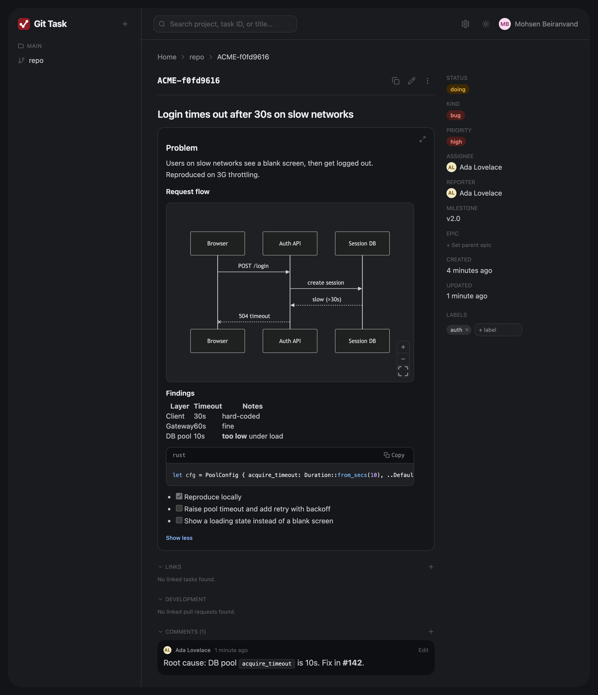

<p align="center">
  
</p>
<h1 align="center">Git Task</h1>

<p align="center">A local web app for managing tasks tracked in your git repos with <a href="https://github.com/imohsenb/git-task">git-task</a>. Board, list, and table views, milestones, members, and sync, all backed by your own repo. No database, no account, nothing to host.</p>

<p align="center"><a href="https://www.npmjs.com/package/git-task-web">npm</a></p>

<p align="center">
  
</p>

## Install

```sh
brew install imohsenb/tap/git-task
```

This installs the [git-task](https://github.com/imohsenb/git-task) CLI, which fetches and runs this web app for you.

## Usage

```sh
git task web start
```

If Git Task isn't installed yet, this prompts to install it, then starts the server. Open
`http://localhost:4600`. Register a repo from Settings (by local path, or clone one by URL), and you're
on the board.

```sh
git task web stop
```

Stops it.

You can also install and run Git Task directly, without going through the `git task` CLI:

```sh
npm install -g git-task-web
git-task-web
```



## What you can do

- **Board, List, and Table views**, with filters and search. Drag cards between columns on the board
  to change status.
- **Rich markdown** in descriptions and comments: GitHub-flavored tables, task lists, and syntax-highlighted
  code blocks with a copy button.
- **Mermaid diagrams**, rendered inline from ```` ```mermaid ```` blocks (flowcharts, sequence diagrams, and more)
  with pan and zoom.
- **Write and preview**, edit markdown with a live preview in the new-task and edit dialogs.
- **Epics and links**, parent epics, plus `blocks` / `relates` / `dup` links between tasks that you can click through.
- **Development**, open pull requests per repo and per project.
- **Milestones**, tasks grouped by their milestone.
- **Members**, a directory of everyone who's shown up as an assignee, reporter, or commenter.
- **Home**, tasks assigned to you and recent activity, across every repo you've registered.
- **Sync**, push and pull per repo, with a one-click sync-all.
- **Live updates**, the UI stays current whether a change came from this app or from `git task` in a
  terminal.
- **Light and dark themes**.

Keyboard shortcuts: `c` for a new task, `/` to search, `Esc` to close a dialog, arrow keys to move
around the board.

## Configuration

Everything is an environment variable:

| Variable | Default | |
|---|---|---|
| `GIT_TASK_WEB_PORT` | `4600` | |
| `GIT_TASK_WEB_HOST` | `127.0.0.1` | Only bind `0.0.0.0` if you're putting an authenticating proxy in front of it. |
| `GIT_TASK_WEB_DATA_DIR` | `~/.local/share/git-task-web` | This app's own UI preferences, nothing task-related. |
| `GIT_TASK_CONFIG_DIR` | `~/.config/git-task` | git-task's own registry; set this to match your terminal's `git task`. |
| `GIT_TASK_BIN` | discovered on `PATH` | Pin a specific binary. |
| `LOG_LEVEL` | `info` | Pino level. |

## Security

This is a single-user tool with no login. Anyone who can reach the port can read and write every repo
you've registered, so keep `GIT_TASK_WEB_HOST` at `127.0.0.1` unless you've put a proper authenticating
proxy in front of it.

## License

MIT, see [LICENSE.md](LICENSE.md).

## Contributing

See [CONTRIBUTING.md](CONTRIBUTING.md) for local development setup, tests, and design docs.
